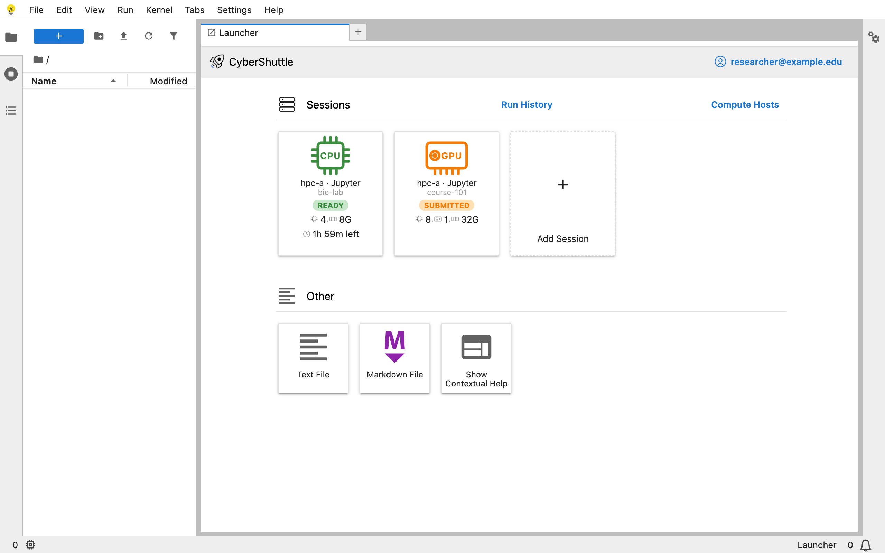
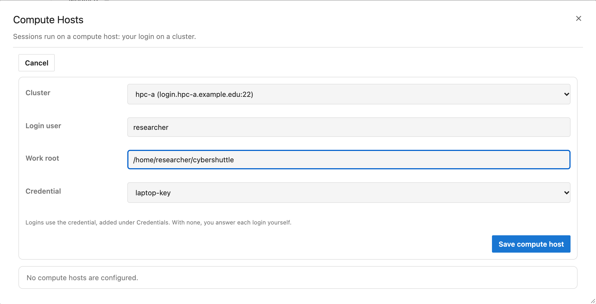
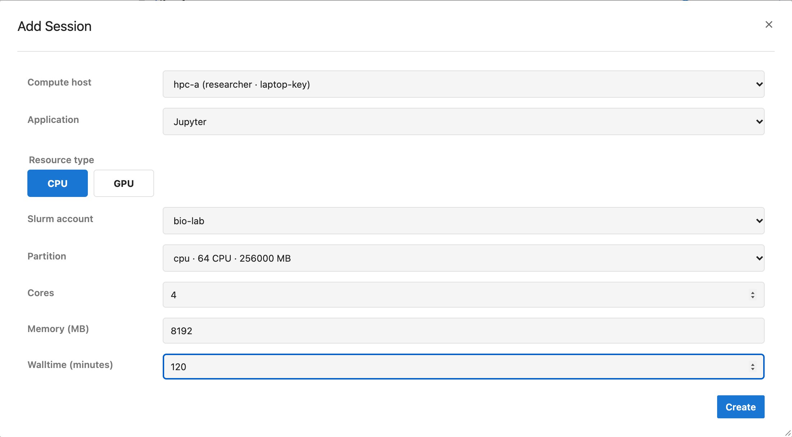
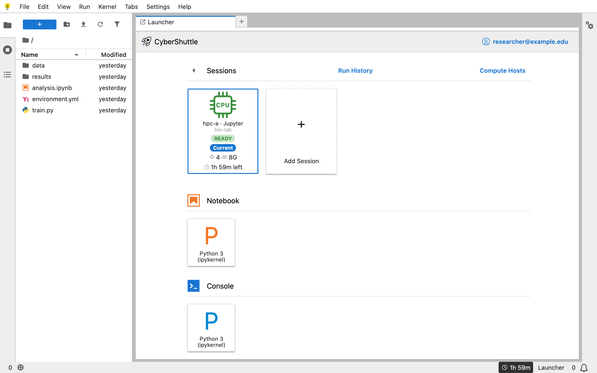
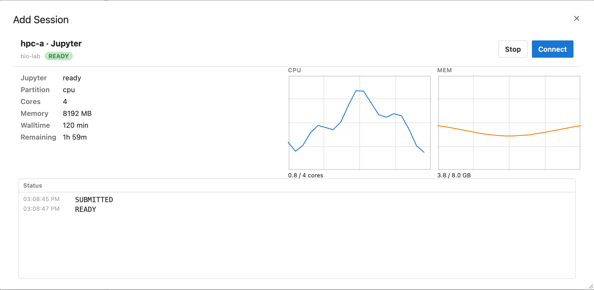
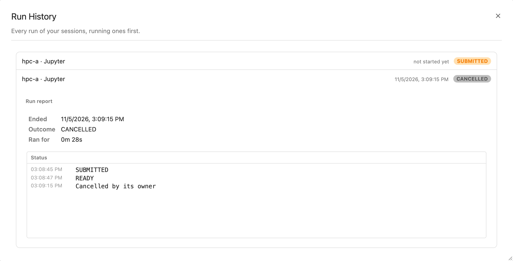

# CyberShuttle Jupyter

CyberShuttle Jupyter runs JupyterLab on a compute node of a Slurm cluster. You use it from a browser. Kernels,
terminals and files stay on the cluster.

Pre-release 0.1.1.

## Features

### Compute hosts

A compute host is your login on a cluster. It holds the cluster, your user name, a work folder and a credential. The
credential is a keypair, a password, or nothing. With nothing stored, a dialog asks for your password at each login.
The same dialog asks for a one-time code when the cluster requires one.

### Sessions from a form

A session is a saved job request that runs a Jupyter server, and you can start it again. Each start is a new Slurm
job in its own folder. The **Add Session** form lists the Slurm accounts and partitions available to your login. You
set cores, memory, GPUs and walltime. **Create** submits the job.

### JupyterLab on the compute node

**Connect** attaches JupyterLab to the session. The file browser shows the run's folder on the cluster.
Notebooks, consoles and terminals run inside the job. The status bar shows the walltime left.

### Usage and status

Each session shows its state, resources and remaining walltime. The session dialog adds CPU, memory and GPU use. It
also logs each state change.

### Run History

**Stop** cancels the Slurm job. **Run History** keeps each session. Each run shows its outcome, duration and
status log.

## Getting started

Requirements:

- The address of a CyberShuttle Jupyter deployment.
- A [CILogon](https://www.cilogon.org/) sign-in. Most universities and research institutions provide one.
- An account on a Slurm cluster that the deployment lists.
- A current browser.

The ARTISAN group runs a deployment at <https://jupyter.cybershuttle.org>. To run your own, follow
[docs/SETTING-UP.md](docs/SETTING-UP.md).

Steps:

1. Open the deployment and choose **Sign in**.
2. Open **Compute Hosts** and add your login on a cluster.
3. Choose **Add Session**, pick the compute host, and choose **Create**.
4. Wait for the session to read `READY`, then choose **Connect**.
5. Choose **Stop** when you finish.

[docs/USING.md](docs/USING.md) shows a recording of each step.

## How it connects

Compute nodes accept no connections from outside the cluster. Each job runs
[Linkspan](https://github.com/cyber-shuttle/linkspan), which connects out to the CyberShuttle API. The browser talks
to the API. The API relays between the browser and the job.

## FAQ

1. **Where is my credential stored?**

   The CyberShuttle API stores it for your account only. The browser sends a private key once, when you save the
   credential. The browser does not keep it.

2. **What happens when the walltime ends?**

   Slurm ends the job. Its kernels and terminals end with it. Countdowns show a warning in the last ten minutes. A
   connected page returns to the Launcher and shows the run's report.

3. **What works without a session?**

   Signing in, compute hosts, credentials and Run History. The file browser is empty. No kernel or terminal starts
   until you connect.

## Documentation

| Document                                     | Covers                                                             |
| -------------------------------------------- | ------------------------------------------------------------------ |
| [docs/USING.md](docs/USING.md)               | Each user task, with a recording                                   |
| [docs/SETTING-UP.md](docs/SETTING-UP.md)     | Commands that start the CyberShuttle API and this site             |
| [docs/ARCHITECTURE.md](docs/ARCHITECTURE.md) | API routes, sign-in, the session lifecycle and fail-closed compute |
| [CONTRIBUTING.md](CONTRIBUTING.md)           | Development setup, scripts and CI                                  |
| [SECURITY.md](SECURITY.md)                   | Vulnerability reports and the client's security properties         |
| [CHANGELOG.md](CHANGELOG.md)                 | Changes in each release                                            |

## Getting help

Search the [issue tracker](https://github.com/cyber-shuttle/cs-jupyter/issues) before opening an issue. Report
security problems through [SECURITY.md](SECURITY.md), not the issue tracker.

## Acknowledgments

Developed by the [ARTISAN research group](https://gt-artisan.github.io/) at Georgia Tech. Built on
[JupyterLite](https://github.com/jupyterlite/jupyterlite), [JupyterLab](https://github.com/jupyterlab/jupyterlab),
[Linkspan](https://github.com/cyber-shuttle/linkspan) and [Slurm](https://slurm.schedmd.com/).

## License

[Apache-2.0](LICENSE)
