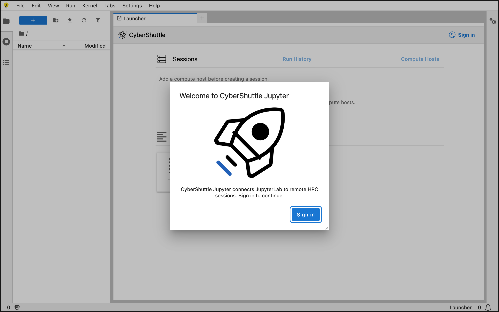
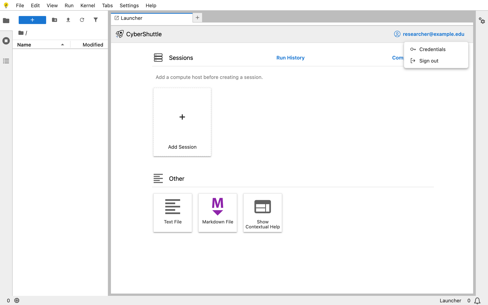
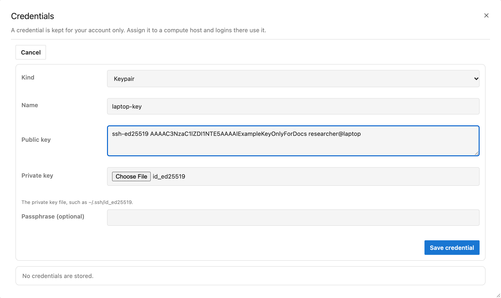
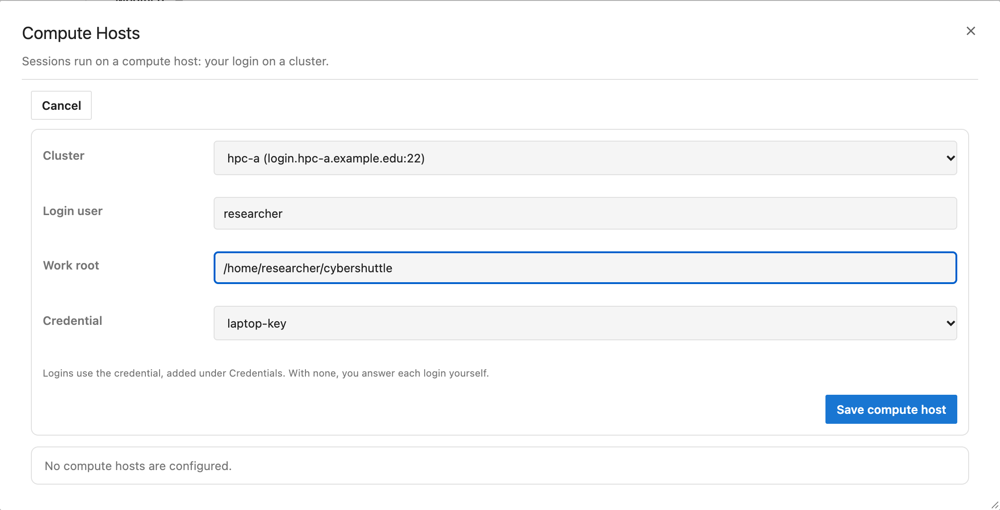
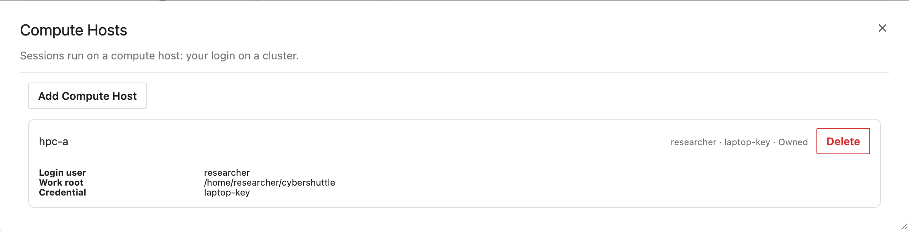
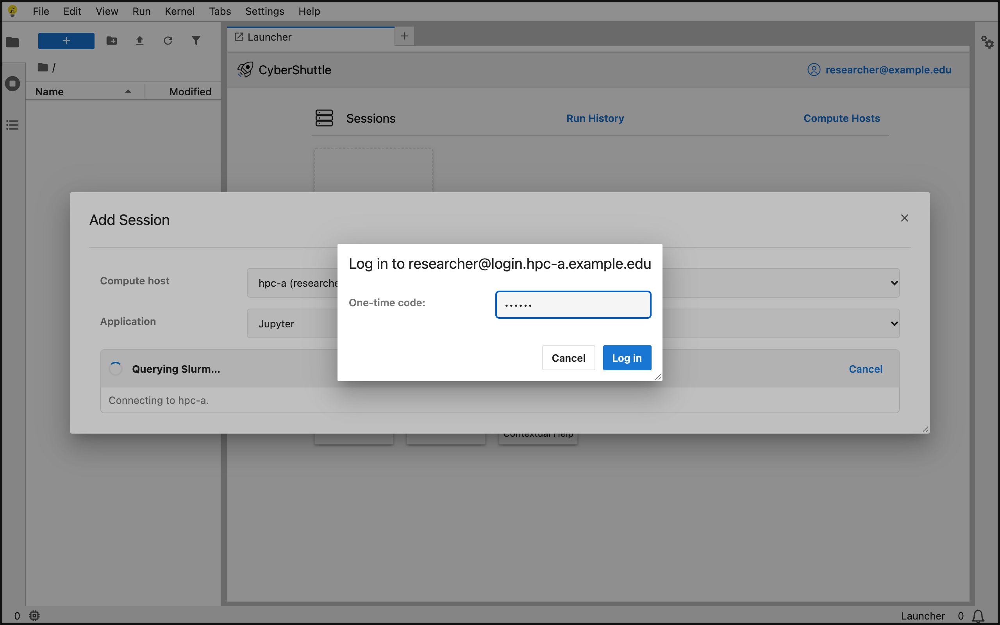
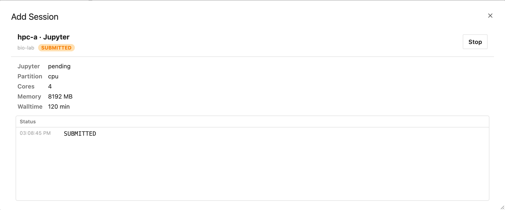
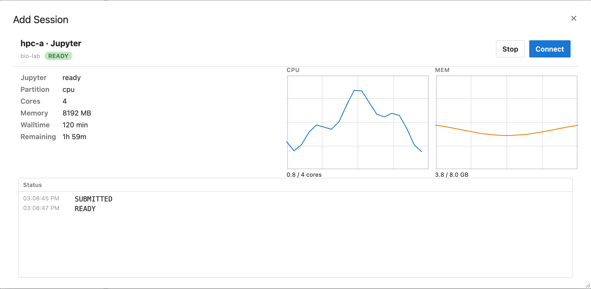
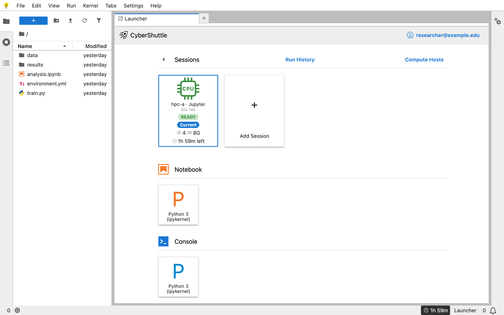
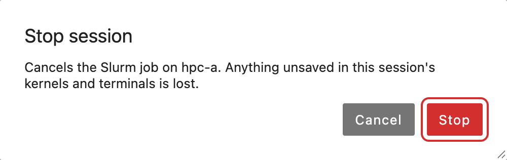

# Using CyberShuttle Jupyter

This guide follows one session from start to finish. You sign in, add your login on a cluster, request a compute
node, work on it, and stop it. Each step shows the screen you should see.

The screenshots use a cluster named `hpc-a` and a user named `researcher`. Your deployment lists its own clusters.

| Step                                           | You do it                |
| ---------------------------------------------- | ------------------------ |
| [1. Sign in](#1-sign-in)                       | Once per browser tab     |
| [2. Add a credential](#2-add-a-credential)     | Once, and it is optional |
| [3. Add a compute host](#3-add-a-compute-host) | Once per cluster         |
| [4. Add a session](#4-add-a-session)           | Each time you want one   |
| [5. Watch the session](#5-watch-the-session)   | While the job waits      |
| [6. Connect](#6-connect)                       | Once the job is running  |
| [7. Stop the session](#7-stop-the-session)     | When you are done        |
| [8. Review past runs](#8-review-past-runs)     | Whenever you like        |

## Terms

| Term         | Meaning                                                                            |
| ------------ | ---------------------------------------------------------------------------------- |
| Compute host | Your login on one cluster: the cluster, your user name, a work root, a credential  |
| Credential   | A keypair or a password that CyberShuttle uses to log in to a compute host for you |
| Work root    | A folder on the cluster. Each session gets its own folder beneath it               |
| Session      | One Slurm job that runs a Jupyter server for you                                   |
| Run          | A session that has ended                                                           |

## 1. Sign in

Open the address of your deployment. A welcome dialog appears.

1. Choose **Sign in**.
2. Pick your institution on the CILogon page and log in there.

The browser returns to CyberShuttle Jupyter. Your account name now shows on the **CyberShuttle** row.

Your sign-in belongs to this browser tab. A new tab asks you to sign in again.

## 2. Add a credential

A credential lets CyberShuttle log in to a cluster for you. This step is optional. Without a credential, a dialog
asks you for your password at each login.

1. Choose your account name on the **CyberShuttle** row.
2. Choose **Credentials**.

3. Choose **Add credential**.
4. Pick a **Kind**: **Keypair** or **Password**.
5. Fill in the fields for that kind.

| Kind     | Field                 | What to enter                                     |
| -------- | --------------------- | ------------------------------------------------- |
| Keypair  | Name                  | A label you will recognise, such as `laptop-key`  |
| Keypair  | Public key            | The contents of the `.pub` file                   |
| Keypair  | Private key           | The private key file, such as `~/.ssh/id_ed25519` |
| Keypair  | Passphrase (optional) | The key's passphrase, if it has one               |
| Password | Name                  | A label you will recognise                        |
| Password | Password              | Your password on the cluster                      |

6. Choose **Save credential**.

The cluster must already accept the key. Add the public key to `~/.ssh/authorized_keys` on the cluster if it is not
there yet.

A credential cannot be edited. To change one, choose **Delete** on it and add it again.

## 3. Add a compute host

A compute host tells CyberShuttle how to log in to a cluster as you. You need one before you can add a session.

1. Choose **Compute Hosts** on the **Sessions** row.
2. Choose **Add Compute Host**.
3. Fill in the four fields.

| Field      | What to enter                                                                |
| ---------- | ---------------------------------------------------------------------------- |
| Cluster    | One of the clusters your deployment lists                                    |
| Login user | Your user name on that cluster                                               |
| Work root  | A folder you can write to on the cluster, such as `/home/<you>/cybershuttle` |
| Credential | A credential from step 2, or **None, ask at each login**                     |

4. Choose **Save compute host**.

The compute host now appears in the list. Choose it to see its details.

A compute host marked **Owned** is yours, and you can delete it. A compute host marked **Shared** belongs to someone
else, and you can only use it.

## 4. Add a session

A session is a Slurm job with a Jupyter server inside it. You describe the job in a form.

1. Choose the **Add Session** card under **Sessions**.
2. Pick a **Compute host**.

CyberShuttle now logs in to the cluster. It reads the Slurm accounts and partitions that your login can use. This
takes a few seconds.

The cluster may ask for something during the login, such as a password or a one-time code. A dialog then shows the
cluster's question. Type the answer and choose **Log in**.

3. Fill in the rest of the form.

| Field              | What to enter                                                       |
| ------------------ | ------------------------------------------------------------------- |
| Application        | The application to run. It is chosen for you when there is only one |
| Resource type      | **CPU** or **GPU**. It shows only when the cluster offers both      |
| Slurm account      | The account the job is charged to                                   |
| Partition          | The partition the job runs in                                       |
| Cores              | At least 2                                                          |
| Memory (MB)        | At least 4096                                                       |
| Walltime (minutes) | How long the job may run. Slurm ends the job when this time is up   |
| GPU type, GPUs     | Shown for **GPU** only                                              |

4. Choose **Create**.

**Create** submits the job to Slurm. The dialog then switches to the new session.

## 5. Watch the session

The session starts in the state `SUBMITTED`. The job is now waiting in the Slurm queue. The **Status** log adds a
line each time the state changes.

You can close the dialog while you wait. The session stays on the Launcher as a card. Choose the card to open the
session again.

| State                              | Meaning                                         | What you can do         |
| ---------------------------------- | ----------------------------------------------- | ----------------------- |
| `CREATED`                          | The session is saved but was never submitted    | **Start** submits it    |
| `SUBMITTED`                        | The job is waiting in the queue                 | **Stop** cancels it     |
| `READY`, `RUNNING`                 | The job is running on a compute node            | **Connect** or **Stop** |
| `COMPLETED`, `FAILED`, `CANCELLED` | The job has ended, and the session is now a run | Open it in Run History  |

The state becomes `READY` once the job starts. The **Jupyter** line then changes from `pending` to `ready`, and the
**Connect** button appears. The dialog now also shows the time remaining and plots of the job's CPU and memory use.
A GPU session adds a GPU plot.

## 6. Connect

1. Open the session.
2. Choose **Connect**.

The page reloads onto the session. JupyterLab now works on the compute node.

| Part of the page | What it shows                                                             |
| ---------------- | ------------------------------------------------------------------------- |
| File browser     | The session's folder on the cluster, beneath the compute host's work root |
| Notebook         | The kernels that the job offers. A notebook runs on the compute node      |
| Terminal         | A shell on the compute node. Find it under **Other** on the Launcher      |
| Session card     | The session you are connected to is marked **Current**                    |
| Status bar       | The walltime left. It turns to a warning colour in the last ten minutes   |

The arrow beside **Sessions** returns you to the list of sessions. Returning to the list does not stop the session.
To move to another session, open it and choose **Connect**.

Save your work before the walltime runs out. Slurm ends the job at that moment, and its kernels and terminals end
with it. The page then returns to the Launcher and shows the run's report.

## 7. Stop the session

Stop a session when you are done. Stopping releases the allocation, so the job stops using your Slurm account.

1. Open the session.
2. Choose **Stop**.
3. Confirm with **Stop**.

Stopping cancels the Slurm job. Anything unsaved in its kernels and terminals is lost. Files you saved stay on the
cluster.

Closing the tab or signing out does not stop a session. The job keeps running until you stop it or its walltime runs
out.

An ended session cannot be started again. Choose **Add Session** to submit a new job.

## 8. Review past runs

1. Choose **Run History** on the **Sessions** row.
2. Choose a run to open its report.

Run History lists your running sessions first. Your ended runs follow, newest first. A report shows when the run
ended, its outcome, how long it ran and its status log. A failed run also shows the error.

## Signing out

1. Choose your account name on the **CyberShuttle** row.
2. Choose **Sign out**.

Your sessions keep running on the cluster after you sign out.

## When something goes wrong

| You see                                                | What it means                                    | What to do                                                  |
| ------------------------------------------------------ | ------------------------------------------------ | ----------------------------------------------------------- |
| `Add a compute host before creating a session.`        | You have no compute host yet                     | Follow [step 3](#3-add-a-compute-host)                      |
| `No CPU or GPU Slurm partitions were discovered for …` | The cluster reported no partition for your login | Ask the cluster's support which partitions you may use      |
| A session stays `SUBMITTED`                            | The job is still waiting in the Slurm queue      | Wait, or stop it and ask for fewer resources                |
| The session is `READY` but **Jupyter** stays `pending` | The Jupyter server has not answered yet          | Wait. The first session on a cluster takes a few minutes    |
| The status log says the job `runs without a link`      | The job runs, but CyberShuttle cannot reach it   | Stop the session and report the log line to your deployment |
| `Session updates unavailable.`                         | The browser cannot reach the CyberShuttle API    | Check your network. The page keeps trying                   |
| `Sign in again to resume session updates.`             | Your sign-in has expired                         | Choose **Sign in**                                          |
