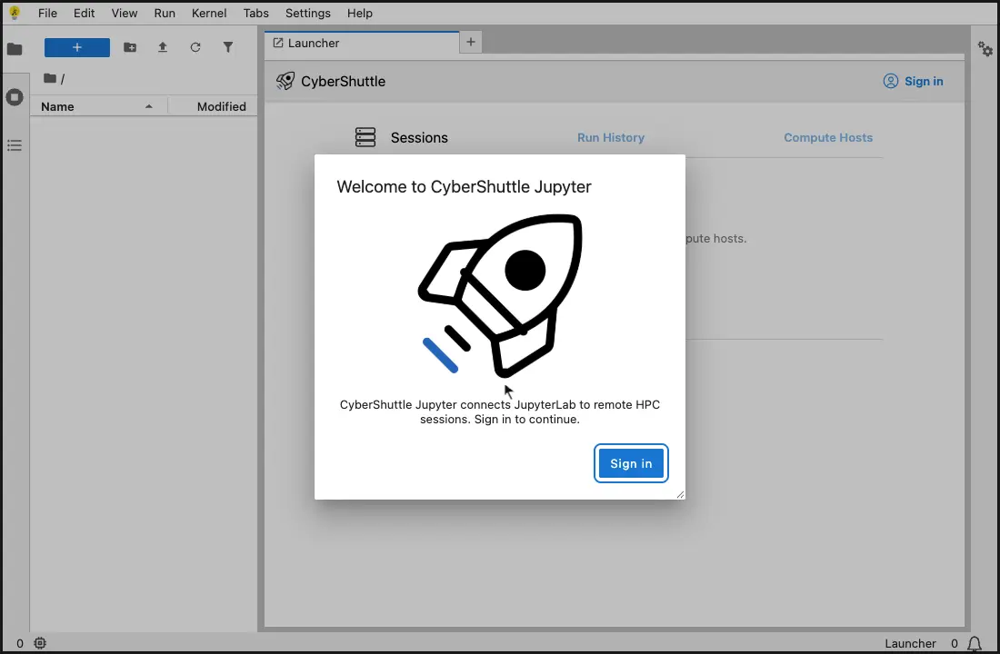
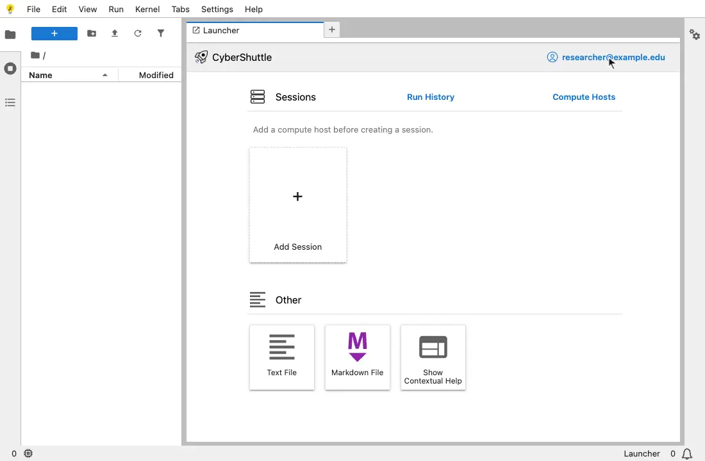
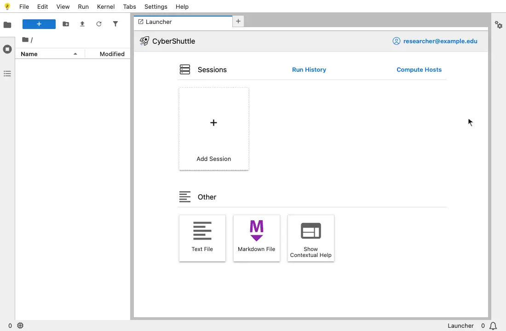
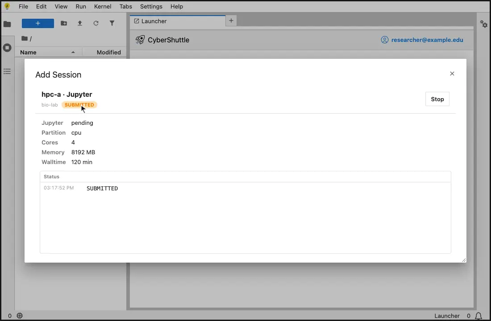
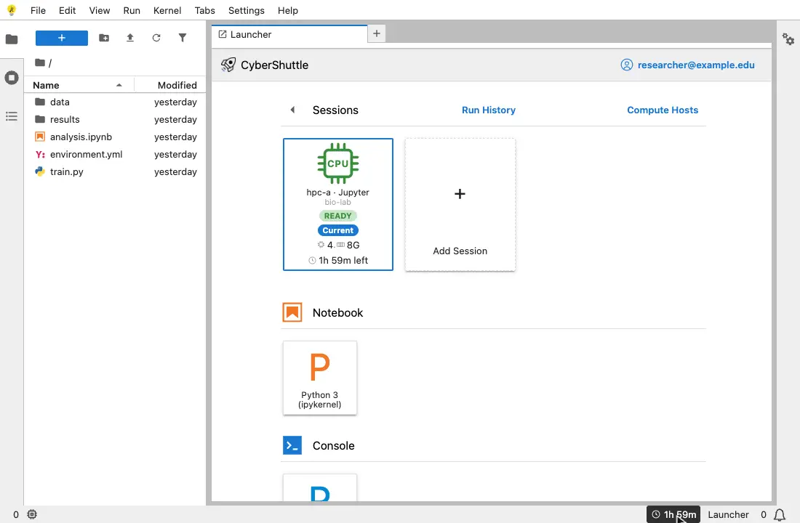

# Using CyberShuttle Jupyter

This guide follows one session from sign-in to stop.

The recordings use a cluster named `hpc-a` and a user named `researcher`. Your deployment lists its own clusters.

| Step                                                                   | When                 |
| ---------------------------------------------------------------------- | -------------------- |
| [1. Sign in](#1-sign-in)                                               | Once per browser tab |
| [2. Add a credential](#2-add-a-credential)                             | Once. Optional       |
| [3. Add a compute host](#3-add-a-compute-host)                         | Once per cluster     |
| [4. Add a session](#4-add-a-session)                                   | For each session     |
| [5. Connect](#5-connect)                                               | When the job runs    |
| [6. Stop the session and review it](#6-stop-the-session-and-review-it) | When you finish      |

## Terms

| Term         | Meaning                                                             |
| ------------ | ------------------------------------------------------------------- |
| Compute host | Your login on one cluster                                           |
| Credential   | A keypair or a password that logs in to a compute host              |
| Work root    | A folder on the cluster. Each session gets its own folder inside it |
| Session      | One Slurm job that runs a Jupyter server                            |
| Run          | An entry in Run History: a running or ended session                 |

## 1. Sign in

1. Open the address of your deployment. A welcome dialog appears.
2. Choose **Sign in**.
3. Pick your institution on the CILogon page and log in. The recording skips this page.

The browser returns to CyberShuttle Jupyter. Your account name shows on the **CyberShuttle** row.

The sign-in is stored per tab. A new tab asks you to sign in again.

## 2. Add a credential

Without one, a dialog asks for your password at each login.

1. Choose your account name on the **CyberShuttle** row.
2. Choose **Credentials**.
3. Choose **Add credential**.
4. Pick a **Kind** and fill in its fields.
5. Choose **Save credential**.

| Kind     | Field                 | Value                                             |
| -------- | --------------------- | ------------------------------------------------- |
| Keypair  | Name                  | A label, such as `laptop-key`                     |
| Keypair  | Public key            | The contents of the `.pub` file                   |
| Keypair  | Private key           | The private key file, such as `~/.ssh/id_ed25519` |
| Keypair  | Passphrase (optional) | The key's passphrase                              |
| Password | Name                  | A label                                           |
| Password | Password              | Your password on the cluster                      |

The cluster must accept the key. If it does not, add the public key to `~/.ssh/authorized_keys` on the cluster.

A credential cannot be edited. To change one, delete it and add it again.

## 3. Add a compute host

A session needs a compute host.

1. Choose **Compute Hosts** on the **Sessions** row.
2. Choose **Add Compute Host**.
3. Fill in the four fields.
4. Choose **Save compute host**.

| Field      | Value                                                                        |
| ---------- | ---------------------------------------------------------------------------- |
| Cluster    | A cluster from the list                                                      |
| Login user | Your user name on that cluster                                               |
| Work root  | A folder you can write to on the cluster, such as `/home/<you>/cybershuttle` |
| Credential | A credential from step 2, or **None, ask at each login**                     |

The compute host appears in the list. Choose it to see its details.

| Label      | Meaning                                    |
| ---------- | ------------------------------------------ |
| **Owned**  | You added it. You can delete it            |
| **Shared** | Another user added it. You can use it only |

## 4. Add a session

A form describes the job.

1. Choose the **Add Session** card under **Sessions**.
2. Pick a **Compute host**. The CyberShuttle API logs in to the cluster and reads your Slurm accounts and partitions.
3. If a dialog asks for a password or a one-time code, enter it and choose **Log in**.
4. Fill in the rest of the form.
5. Choose **Create**.

| Field              | Value                                                      |
| ------------------ | ---------------------------------------------------------- |
| Application        | The application to run. **Base** is preselected if present |
| Resource type      | **CPU** or **GPU**. Shown when the cluster offers both     |
| Slurm account      | The account the job is charged to                          |
| Partition          | The partition the job runs in                              |
| Cores              | At least 2                                                 |
| Memory (MB)        | At least 4096                                              |
| Walltime (minutes) | The job's time limit. Slurm ends the job at the limit      |
| GPU type, GPUs     | Shown for **GPU** only                                     |

**Create** submits the job to Slurm. The dialog then shows the new session in the state `SUBMITTED`.

You can close the dialog. The session stays on the Launcher as a card. Choose the card to open it again.

| State                              | Meaning                         | Actions                 |
| ---------------------------------- | ------------------------------- | ----------------------- |
| `CREATED`                          | Saved, not submitted            | **Start** submits it    |
| `SUBMITTED`                        | Waiting in the Slurm queue      | **Stop** cancels it     |
| `READY`, `RUNNING`                 | Running on a compute node       | **Connect** or **Stop** |
| `COMPLETED`, `FAILED`, `CANCELLED` | Ended. The session is now a run | Open it in Run History  |

## 5. Connect

1. Wait for the state to read `READY`. The **Status** log adds a line at each state change.
2. Wait for the **Jupyter** line to read `ready`. The **Connect** button appears.
3. Choose **Connect**.

The dialog also shows the time remaining and plots of CPU and memory use. A GPU session adds a GPU plot.

**Connect** reloads the page onto the session. JupyterLab then runs on the compute node.

| Part of the page | Shows                                                              |
| ---------------- | ------------------------------------------------------------------ |
| File browser     | The session's folder inside the work root                          |
| Notebook         | The kernels that the job offers                                    |
| Terminal         | A shell on the compute node. It is under **Other** on the Launcher |
| Session card     | **Current** marks the connected session                            |
| Status bar       | The walltime left. It changes colour in the last ten minutes       |

The arrow beside **Sessions** returns to the list of sessions. The session keeps running. To switch sessions, open
another one and choose **Connect**.

Save your work before the walltime ends. Slurm then ends the job, with its kernels and terminals. The page returns to
the Launcher and shows the run's report.

## 6. Stop the session and review it

1. Choose the arrow beside **Sessions** to return to the list.
2. Open the session.
3. Choose **Stop**, then confirm with **Stop**.
4. Choose **Run History** on the **Sessions** row.
5. Choose the run to open its report.

**Stop** cancels the Slurm job and releases its allocation. Unsaved work in kernels and terminals is lost. Saved
files stay on the cluster.

Run History lists running sessions first, then ended runs, newest first. A report shows the end time, the outcome,
the duration and the status log. A failed run also shows the error.

An ended session cannot be started again. Add a new session.

## Signing out

1. Choose your account name on the **CyberShuttle** row.
2. Choose **Sign out**.

Signing out or closing the tab does not stop a session. The job runs until you stop it or its walltime ends.

## Troubleshooting

| Message or symptom                                     | Cause                                                  | Action                                                  |
| ------------------------------------------------------ | ------------------------------------------------------ | ------------------------------------------------------- |
| `Add a compute host before creating a session.`        | You have no compute host                               | Follow [step 3](#3-add-a-compute-host)                  |
| `No CPU or GPU Slurm partitions were discovered for …` | The cluster reported no partition for your login       | Ask the cluster's support which partitions you may use  |
| A session stays `SUBMITTED`                            | The job is waiting in the Slurm queue                  | Wait, or stop it and request fewer resources            |
| The session is `READY` but **Jupyter** stays `pending` | The Jupyter server has not answered yet                | Wait. The first session on a cluster takes longer       |
| The status log says the job `runs without a link`      | The job runs, but the CyberShuttle API cannot reach it | Stop the session. Report the log line to the deployment |
| `Session updates unavailable.`                         | The browser cannot reach the CyberShuttle API          | Check your network. The page retries                    |
| `Sign in again to resume session updates.`             | Your sign-in has expired                               | Choose **Sign in**                                      |
